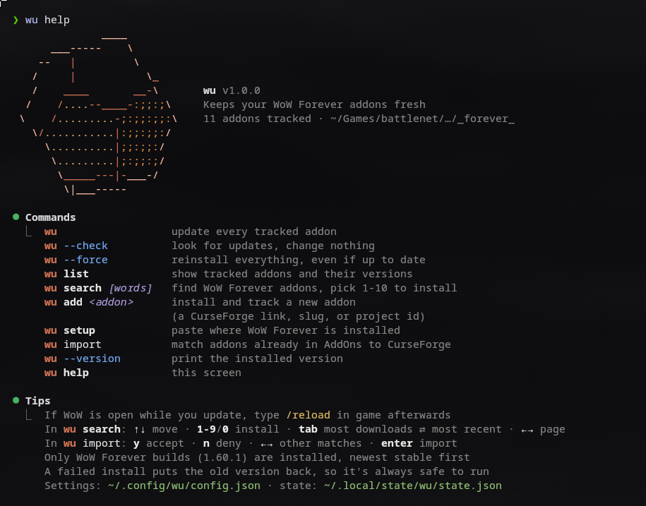

# wu

A terminal addon manager for **World of Warcraft: Forever**. Update, search, import and
install addons from CurseForge, with a spinning ASCII engram and a WoW cast bar while it works.



## Install

You need [Bun](https://bun.sh) and `python3` (any recent version, standard library only).

```sh
bun add -g github:EndreJohnsen/wu
```

Run the same command again to upgrade (if it ever keeps an old copy, run
`bun remove -g @endrejohnsen/wu` first). Then:

```sh
wu setup    # finds WoW Forever in your Wine/Proton/Lutris/Bottles prefixes, or paste the path
wu import   # adopt the addons you already have
wu          # keep everything up to date
```

## Commands

| Command | What it does |
| --- | --- |
| `wu` | update every tracked addon |
| `wu --check` | look for updates, change nothing |
| `wu --force` | reinstall everything, even if up to date |
| `wu list` | tracked addons and their installed versions |
| `wu search [words]` | top 10 WoW Forever addons for a search; press `1`–`9`/`0` to install, `tab` to switch most downloads ⇄ most recent, `←→` to page |
| `wu add <addon>` | install and track one addon (CurseForge link, slug or project id) |
| `wu import [--yes]` | match the addons already in `Interface/AddOns` to CurseForge, then accept (`y`) or deny (`n`) each match |
| `wu setup [path]` | set where WoW Forever lives; Linux paths, `C:\…` Windows paths, `file://` links, `Wow.exe` all work |
| `wu --version` | print the installed version |
| `wu help` | the screen above |

If WoW is running while you update, type `/reload` in game afterwards.

## How it works

- Only **WoW Forever builds** (CurseForge game version `1.60.1`) are installed, newest stable first.
- File lists come from [cfwidget](https://api.cfwidget.com) and search from
  [curse.tools](https://api.curse.tools), a keyless proxy of the official CurseForge API.
  The CurseForge website itself blocks scripts.
- Downloads come straight from CurseForge's CDN (`edge.forgecdn.net`) and are size-checked.
  Folders are swapped in with a rollback, so a failed install puts the previous version back.
- `wu import` matches folders by the CurseForge project id in their `.toc`, then by the folder
  names each CurseForge project ships (so `Details_*` modules group under Details), then by name.

| What | Where |
| --- | --- |
| WoW path | `~/.config/wu/config.json` (or the `WU_DIR` environment variable) |
| Tracked addons | `~/.local/state/wu/state.json` |

Works on Linux and macOS terminals. Windows isn't supported (it uses Unix terminal APIs);
on Windows the CurseForge app does the same job.
